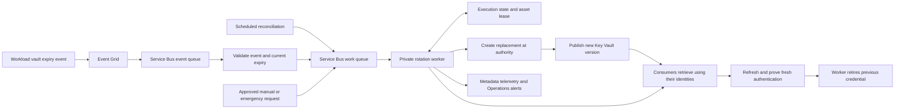

# Secrets Rotation DevOps Implementation Guide

This guide explains how the Terraform and runtime code implement the secrets
rotation service, how workloads connect to it, and how DevOps operates it. The
security lead's design remains the authority for approved controls, intervals and
exceptions; this README describes the implementation rather than replacing that design.

The service changes a credential **at its source**, publishes its replacement to
Key Vault, coordinates application adoption, validates fresh authentication, then
retires the previous credential. Updating a vault value alone is not rotation.
Prefer managed identity or federation before onboarding a stored credential.

## Solution Flow



1. **Identify work.** The scheduler reads the approved asset registry, vault
   metadata and execution state. Events and approved operator requests provide
   additional entry points; they do not bypass asset eligibility checks.
2. **Queue identifiers.** Service Bus carries asset IDs, cycle IDs and request
   metadata, never credential values. Separate event and work queues isolate intake
   from execution and provide retries and dead-letter handling.
3. **Serialize execution.** The worker acquires and renews an asset-specific blob
   lease. It checkpoints progress so duplicate delivery does not create another
   replacement or repeat an uncertain destructive operation.
4. **Change the authority and publish.** An adapter regenerates the unused Storage
   key or creates an Entra application password, then writes it directly to a new
   Key Vault secret version. Values remain in memory and Key Vault, not Terraform.
5. **Coordinate adoption.** The worker calls each registered consumer's refresh
   endpoint with the version identifier. The consumer retrieves the credential
   through its own identity and updates its configuration or connections.
6. **Validate.** Every consumer must confirm the same cycle/version and demonstrate
   new authentication plus application health. Before retirement, the worker
   rechecks the published credential and repeats consumer validation.
7. **Retire and close.** After the approved overlap, the worker regenerates/removes
   the previous source credential, disables its old vault version and records the
   next due date. Failed adoption or validation prevents retirement.

The persisted flow is `Requested -> Prechecked -> Creating -> Published ->
ConsumersUpdated -> Validated -> Retiring -> PreviousRetired -> Completed`.
Transient prechecks can enter `PrecheckRetry`; unresolved or unsafe work enters
`ManualIntervention`. Execution state records evidence, not secrets.

## Terraform and Runtime Responsibilities

| Component | Responsibility |
| --- | --- |
| [Deployment root](../../implementations/platform-lz/workspaces/platform-secret-lifecycle) | Supplies environment configuration, enrolled vaults, asset registry, approvals and optional governance assignments |
| [Platform pattern](main.tf) | Creates resource group, two Function Apps, managed identities, host/state storage, Service Bus, private endpoints, scoped RBAC, monitoring and code deployment |
| [Runtime](runtime/function_app.py) | Runs reconciliation, event intake, approved requests and queued execution; [engine](runtime/rotation.py) controls state and [adapters](runtime/ports.py) perform service operations |
| [Vault enrollment](modules/vault-enrollment/main.tf) | Workload-owned vault diagnostics and optional filtered, identity-authenticated Event Grid delivery |
| [Native lifecycle](modules/native-lifecycle/main.tf) | Workload-owned key rotation policies and integrated-CA certificate renewal configuration |
| [Governance](modules/governance/main.tf) | Optional approved policy assignments; does not replace inherited central policy ownership |

The scheduler and worker run as separate Linux Python 3.12 Function Apps on a
dedicated P1v3 plan. Separate host and execution-state storage allow the scheduler
to operate its Functions host without gaining write access to execution checkpoints.

Deploy this root separately for **production and nonproduction**, with independent
subscriptions, identities, queues, registry and execution state. Vaults remain in
their workload subscriptions. Split workers further when IAM permissions or
application trust boundaries require isolation.

DevOps owns the framework, deployment pipeline and reviewed registry. Application
teams own dependency inventory and consumer adoption. Security approves lifecycle
controls and exceptions; IAM approves Graph access, and PKI owns issuer requirements.

Terraform deploys/configures the service; **runtime rotation does not require a
Terraform apply for each cycle**. DevOps changes Terraform inputs when onboarding
assets, adjusting approved lifecycle settings or authorizing an operator request.
The legacy `terraform-azurerm-compeer-security-automation` pattern is delivery-only;
do not leave both handlers rotating the same secret during migration.

## Triggers and Lifecycle Settings

| Entry point | What the code does |
| --- | --- |
| Scheduler | Reconciles every five minutes. Queues due assets, detects actual expiry within 30 days and resumes incomplete executions independently of events |
| Event Grid | Accepts allowlisted `SecretNearExpiry` events. Re-reads current version/expiry; stale events cannot force rotation. New-version events are ignored to prevent loops |
| Planned manual | Private Entra-protected API requires a reviewed request ID matching the asset, mode, expiry and authorized operator object ID |
| Emergency | Requires incident approval and clean-identity confirmation. Creates and validates a replacement, then retires the old credential without the planned minimum overlap |

The timer frequency is not the rotation interval. Each asset declares:

| Setting | Purpose |
| --- | --- |
| `initial_due`, `interval_days` | Initial schedule and interval after a completed cycle |
| `credential_lifetime_days` | Replacement expiry; must exceed the rotation interval |
| `minimum_overlap_minutes`, `overlap_hours` | Planned minimum overlap and maximum permitted adoption/retirement window |
| `owner`, `support_group`, approval/recovery references | Accountability and approved recovery path |
| `adapter_approved`, `consumer_inventory_reviewed`, `enabled` | Reviewed onboarding gates; these are owner attestations, not automated discovery of every dependency |
| `exception_until` | Blocks unattended execution while an exception is active or expired, until reviewed and resolved |

Intervals and thresholds require the security/service owner's approval. Emergency
execution is replacement-first; incident containment that requires immediate
revocation before replacement remains an incident-runbook action.

## Onboard a Workload

Creating a vault does **not** automatically authorize central access or rotate all
its contents. Enrollment is an explicit, reviewed relationship between a vault,
credential authority, worker and known consumers.

### 1. Prepare the Workload Resources

The workload team provisions its vault, target service and consumer identities.
Apply approved RBAC authorization, private connectivity/DNS, purge protection,
soft-delete retention, diagnostics and consumer access. Publish **vault ID and URL**
as workspace outputs; never publish secret values.

Confirm the worker can reach the vault and target APIs, and that consumers can
reach the vault and validate the target service. Network access and identity access
are separate requirements.

### 2. Register the Vault and Credential

In the platform deployment inputs, add the vault to `vaults` and one `assets` entry
per credential. Use the [complete tfvars example](../../implementations/platform-lz/workspaces/platform-secret-lifecycle/terraform.tfvars.example)
and [typed input contract](variables.tf), initially with `enabled=false`.

Supply actual workload outputs through reviewed pipeline inputs or root-level
workspace-output lookups. The current root accepts these as inputs; the reusable
pattern does not automatically discover other workspaces or vaults. Keep output
sharing restricted and avoid reciprocal auto-apply triggers between workspaces.

| Asset | Registration requirements |
| --- | --- |
| Storage account key | `adapter="storage_dual_key"`; Storage account ARM ID; confirm alternate-key nonuse and SAS dependencies; register every consumer |
| Entra application password | `adapter="entra_application"`; application **object ID**, not client ID/service-principal ID; IAM-approved Graph permission and ownership |

The Entra adapter requires IAM-approved `Application.ReadWrite.OwnedBy` and
ownership of the approved applications; Azure Contributor does not grant this access.

Apply the platform inputs to grant the worker access to those vault/account scopes.
Do not register the platform's own host or execution-state storage as a target.

### 3. Establish the Current Credential

Bootstrap the current secret through an approved secure process **outside Terraform**.
Its value must match the authority and its tags must identify:

- `authority_id`: Storage ARM ID or Entra application object ID.
- `credential_id`: `key1`/`key2` or the existing Graph password key ID.

The Storage adapter publishes a raw key; consumers construct connection strings.
Regeneration invalidates SAS signed by that key, so incomplete SAS/dependency
inventory must be resolved before activation.

### 4. Connect the Consumers

Application owners implement the refresh/validation contract below, authorize the
worker identity at those APIs, and grant their own consumer identities the required
vault access. Add each consumer's URLs/audience to the asset and its exact host to
`consumer_hosts`. Platform deployment does not create these application endpoints.

### 5. Attach Optional Vault Events

Scheduler-based rotation works without Event Grid. When event delivery is approved,
call the enrollment module in the **workload root**, using its Azure provider and
the platform's `enrollment` output:

```hcl
module "rotation_enrollment" {
  source = "PATH_TO_CATALOG/patterns/terraform-azurerm-compeer-secret-lifecycle/modules/vault-enrollment"

  vault_id                    = local.workload_vault_id
  resource_group_name         = local.workload_resource_group_name
  location                    = local.location
  topic_name                  = "pilot-vault-lifecycle"
  secret_names                = ["pilot-storage-key"]
  events_enabled              = true
  delivery_exception_approved = local.rotation_enrollment.event_delivery_approved
  queue_id                    = local.rotation_enrollment.queue_id
  dead_letter_storage_id      = local.rotation_enrollment.dead_letter_storage_id
  log_analytics_workspace_id  = local.approved_log_workspace_id
}
```

`local.rotation_enrollment` represents the approved platform output passed into
the workload root. Grant the deploying identity permission to assign topic access
at the destination queue/container scopes, including cross-subscription scopes.
Check for an existing vault system topic and diagnostics first: reuse/import under
one owner rather than creating duplicate resources or competing settings.

### 6. Validate and Activate

Under an approved change, enable only the pilot asset in nonproduction. Prove source
replacement, vault publication, every consumer's fresh authentication and previous-
credential retirement. Test failed adoption, duplicate requests and interrupted
execution. After acceptance, promote the tested configuration/package and authorize
production activation. Subsequent cycles run without a new onboarding change.

For another credential in an enrolled vault, add its asset/consumers and extend the
event allowlist if used. For an unsupported authority, implement and test its adapter
before extending the schema; changing a vault value is not a substitute.
Keys and certificates follow the native-lifecycle module path described below;
they are not supported entries in the secret worker's `assets` registry.

## Consumer Integration Contract

The worker sends identifiers, not credentials, to two Entra-protected HTTPS endpoints:

| Endpoint | Required consumer behavior |
| --- | --- |
| `refresh_url` | Idempotently adopt the requested version, refreshing configuration, connections or deployment as needed |
| `validate_url` | Retrieve that version with the consumer identity, establish new authentication and perform a representative authorized operation |

Request example:

```json
{"cycle":"cycle-id","vault_url":"https://example.vault.azure.net",
 "secret_name":"credential","version":"new-version","stage":"validate"}
```

Return HTTP 202 while pending. Return HTTP 200 with matching cycle/version and
`healthy=true` when ready; validation also requires `fresh_authentication=true`:

```json
{"cycle":"cycle-id","version":"new-version","healthy":true,"fresh_authentication":true}
```

A generic HTTP health check does not prove adoption. Endpoints must authenticate
the worker and enforce asset/version scope. All registered consumers must pass;
the worker does not follow redirects or send tokens to unapproved hosts.

## Security and Policy Enforcement

| Layer | How it is maintained |
| --- | --- |
| Workload identity | Consumers use their own identities. Scheduler has metadata-only vault access; worker has enrolled-vault Secrets Officer and target-account Key Operator roles |
| IAM isolation | Graph consent and application ownership remain IAM-controlled. Use a separate approved worker boundary where these permissions are required |
| Private connectivity | Functions integrate with a delegated subnet; separate private endpoints serve apps, messaging and storage. Workload vault endpoints/DNS remain workload-owned |
| Runtime safeguards | Eligibility gates, asset leases, stable cycle IDs, configuration fingerprints and persisted intent prevent conflicting execution or unsafe replay |
| Credential handling | No credential values in tfvars, outputs, messages, checkpoints or telemetry. Generated values are published directly to Key Vault |
| Azure Policy | Existing central controls remain authoritative. Optional `governance_policies` assignments use approved definitions/parameters; defaults are empty to avoid duplicate ownership |
| Approval and audit | Restricted HCP changes, scoped Entra operator access, expiring request authorizations and metadata-only evidence support review and investigation |

Secrets Officer is broader than write-only. Review custom roles or split workers
when a vault contains assets outside the worker's trust boundary. Deployment needs
Contributor plus constrained role-assignment permissions; routine Owner access is
not the intended model. Graph consent is separate from Azure RBAC.

Azure Policy validates configuration such as RBAC, recovery, public access, expiry
and rotation-policy settings. It does not prove that consumers adopted a credential.
Assign workload controls at the workload's subscription/management-group scope;
an assignment on the platform subscription does not cover every workload vault.
DINE/Modify identities and remediation remain with the central governance owner.

**Event delivery is an explicit network decision.** Default mode disables public
storage/messaging access. Event Grid does not push through these private endpoints.
After approval, `event_delivery_exception_approved=true` enables default-deny public
Service Bus/state-storage endpoints with trusted-service exceptions and topic-scoped
RBAC. If that exception is prohibited, retain scheduler/manual processing.

Resolve private app/SCM, vault, storage and Service Bus names from workers and the
deployment runner. Permit approved outbound Entra, ARM, Graph, monitoring, runtime
dependency and consumer API traffic through the firewall. Set `dns_owned_by_policy`
only when central policy actually supplies private endpoint zone groups.

## Deployment and Day Two Operation

1. Deploy the [root](../../implementations/platform-lz/workspaces/platform-secret-lifecycle)
   with actual approved inputs, assets disabled and `package_path=null`.
2. Validate private connectivity, DNS, RBAC and the existing Entra manual API registration.
3. Build the locked Python 3.12 package on Linux. The CI workflow validates code,
   runs mocked tests and publishes a ZIP/digest; it does not deploy to Compeer.
4. Set `package_path` and apply from an approved private runner. Authenticate both
   Terraform and Azure CLI through the approved federation process; provider
   authentication does not automatically sign the CLI in. Basic publishing stays off.
5. The deploy script targets the explicit subscription and verifies all four
   Functions index. Confirm heartbeat and alerts, then onboard a controlled
   nonproduction pilot before approving production assets.

Changing the registry/approvals updates app settings and redeploys the package;
queues and execution state persist. Changing an in-flight asset's configuration
blocks execution for reconciliation rather than retiring against a changed target.

Manual/emergency execution requires an approved `manual_approvals` record, then an
authenticated POST to the `manual_request_url` output:

```json
{"asset_id":"pilot-storage","request_id":"approved-request-id","mode":"manual"}
```

App Service Easy Auth enforces Entra authentication/group restrictions; never
disable it because the Functions HTTP binding does not use a function key.
For emergency mode, confirm a clean execution identity and follow incident authority;
never restore a compromised credential.

Operations receives failure, overdue, missing-heartbeat, persistent-backlog and
dead-letter alerts through approved action groups. Logs correlate asset, environment,
cycle, phase and reason. Existing ticket/SOC routing and approved evidence retention
must be connected through the organization's operational process.

When work enters `ManualIntervention`, reconcile the source credential, vault
versions, consumers and checkpoint before resuming. An unpublished one-time password
or uncertain key regeneration is not blindly retried. Inspect/reconcile dead-letter
messages before replay; restore vault RBAC, networking and event integration as well
as vault contents during recovery.

## Supported Scope and Acceptance

| Asset category | Current implementation |
| --- | --- |
| Storage dual keys and Entra application passwords | Authority adapters plus publication, consumer coordination, validation and retirement |
| Cryptographic keys | Native rotation-policy module; no automatic historical-key retirement or re-encryption |
| Integrated-CA certificates | Native renewal configuration; service-specific binding/deployment and presented-certificate validation are additional integrations |
| Database, third-party API, legacy/PAM and nonintegrated CA | Require provider-specific adapters and tested recovery before automated onboarding |

Manage native keys/certificates from the vault owner's root using
[native-lifecycle](modules/native-lifecycle/main.tf). Import existing resources
before adopting them; do not recreate encryption keys. Rotation/renewal does not
prove historical decryption or endpoint deployment, and old encryption-key versions
must remain available while dependencies require them.

Use [ACCEPTANCE.md](ACCEPTANCE.md) for live acceptance gates and the
[deployment root guide](../../implementations/platform-lz/workspaces/platform-secret-lifecycle/README.md)
for prerequisites. Local tests and successful packaging are not evidence of a client
end-to-end rotation. Production activation requires nonproduction evidence and the
security/service owners' approval.
