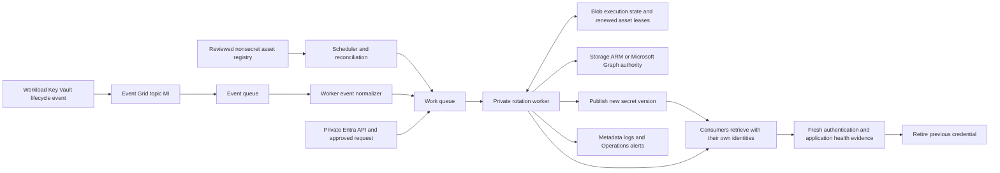

# Key Vault Lifecycle and Secrets Rotation Automation

This pattern implements the framework in `Design_Secrets_Rotation_Automation_Updated.docx`:
create at the authority, publish to Key Vault, refresh every registered consumer,
prove fresh authentication, then retire the previous credential. Writing a random
value to Key Vault alone is **not** credential rotation.

## Implementation Boundary

| Capability | Implementation |
| --- | --- |
| Platform infrastructure | Terraform provisions private Functions, separate identities, host/state storage, Service Bus, endpoints, RBAC, diagnostics and alerts |
| Scheduled and missed-event processing | Scheduler reconciles every five minutes; registry dates determine daily/interval eligibility, with incomplete execution resumption |
| Key Vault events | Workload enrollment module sends filtered SecretNearExpiry events to a separate queue using topic managed identity |
| Planned manual and emergency requests | Private Entra-protected API, reviewed expiring request authorizations and operator object-ID checks |
| Storage keys | Concrete dual-key regeneration, publication, consumer verification and previous-key regeneration |
| Entra application credentials | Concrete Graph addPassword/removePassword adapter; separate IAM consent and ownership approval required |
| Cryptographic keys | Native-lifecycle module manages rotation policies; prior versions are never automatically retired |
| Integrated-CA certificates | Native-lifecycle module manages issuance/renewal policies; workload-specific certificate deployment and endpoint verification remain required |
| Database, third-party API, legacy/PAM, nonintegrated CA | Not implemented as generic adapters. Block unattended onboarding until a provider-specific adapter and recovery tests are added |

**Not a production-readiness declaration:** credentials, inventory, consumers,
network exceptions, IAM/PKI approvals and live failure/recovery tests are not
provided by the design. The examples are disabled until these are supplied.
No resource has been deployed to Azure by adding this pattern.
The [end-to-end acceptance gate](ACCEPTANCE.md) distinguishes verified code from
pending client deployment, integration and operational approval.

The existing `terraform-azurerm-compeer-security-automation` pattern is legacy
event-to-external-handler wiring. It is preserved, not silently changed or moved.
Never enroll the same vault/secret in both systems. New full-framework deployments
use `implementations/platform-lz/workspaces/platform-secret-lifecycle`.

## Architecture and Ownership



Use **separate prod and nonprod HCP workspaces and subscriptions**, per design
sections 3.2 and 3.3. Each deployment has independent identities, registry, queues,
state and manual API registration. Do not combine these environments in one state.
Create additional deployments when Graph/IAM, business criticality or application
trust boundaries require narrower workers. This pattern does not grant Graph
permissions to every deployment automatically.

Vault owners retain workload vaults, private endpoints, DNS, consumers, native key/
certificate objects and enrollment topics. Platform Engineering owns the worker
deployment and reviewed registry. IAM owns Graph consent and application ownership;
PKI owns CA integration. Central governance owns inherited policies and remediation.

## What Terraform Does

`main.tf` provisions two Linux Python 3.12 Function Apps on a dedicated P1v3 plan.
Dedicated always-on hosting avoids the Azure Files connection string required by
some Elastic Premium deployment options. Function host storage uses UAMI auth,
not access keys. Host storage is separate from metadata storage so scheduler host
permissions do not accidentally permit writes to execution state.

The scheduler can read execution metadata, list vault object metadata through
Key Vault Reader and send work, but cannot retrieve secret values.
The worker receives work, renews a per-asset blob lease and stores metadata-only
checkpoints. Workload-scoped Secrets Officer and account-scoped Key Operator roles
are assigned only for registered resources. Secrets Officer is broader than
write-only: split workers or substitute reviewed custom roles for stronger isolation.

`package_path` optionally deploys a built ZIP to both apps using `terraform_data`
and Azure CLI. Package hash and Function App changes trigger redeployment, including
recovery of a recreated app at the same Azure resource ID. The deploy script targets
the app's explicit subscription and checks all four Functions have indexed; a ZIP
upload alone does not count as successful deployment. Basic publishing remains
disabled; a private runner authenticated to Azure CLI uses Entra deployment access.
Terraform provider authentication does **not** automatically sign Azure CLI in.
Use a federated runner/bootstrap step; never inject a deployment password.

Terraform does not create secret values, Graph passwords, storage keys or consumer
tokens. Those exist only in worker memory and Key Vault. Protect Terraform state
nonetheless: it contains registry metadata, application IDs and infrastructure data.

## Triggers and Lifecycle Policy

| Trigger | Behavior and safeguards |
| --- | --- |
| Schedule | Initial due date and last completed cycle drive the next rotation; interval is asset-specific, not the Functions timer frequency |
| Event Grid | Only allowlisted vaults/secrets and SecretNearExpiry are accepted. Current version/expiry is re-read; a verified near-expiry version can advance the normal due date |
| New-version event | Ignored, preventing self-triggered rotation loops |
| Manual | Approved request ID, asset, mode, expiry and caller object ID must match reviewed Terraform input |
| Emergency | Requires incident approval and explicit clean-identity confirmation; no compromised rollback. Replacement-first workflow only; immediate pre-replacement containment is an incident-runbook operation |
| Recovery | Incomplete work is requeued every five minutes. Ambiguous create/retire outcomes require reconciliation, never blind destructive replay |

`interval_days`, `credential_lifetime_days`, `overlap_hours` and
`minimum_overlap_minutes` are organizational policies, not universal Microsoft
requirements. Storage example alternates every 45 days. Application-secret example
can use 90-day cycles with enough validity margin. Approve these with service owners.
An active or expired exception blocks automation; expiry never authorizes unsafe work.
Scheduler metadata scans also detect actual expiries within 30 days, independently
of event delivery. The worker rechecks that expiry before acting, so stale metadata
cannot force another rotation. Missing registered secrets are governance alerts.

```text
Requested -> Prechecked -> Creating -> Published -> ConsumersUpdated
          -> Validated -> Retiring -> PreviousRetired -> Completed
```

`Creating` and `Retiring` are persisted intent states around nontransactional
authority operations. Runtime failures preserve the phase and set bounded retry
timing; five failures escalate to `ManualIntervention`. An uncertain creation is
recovered using Key Vault version tags containing the cycle ID. If a one-time Graph
password was created but not published, automatic recovery stops: reconcile and
revoke the orphan under the runbook before authorizing another cycle.

Consumer failures never trigger retirement. Every consumer must acknowledge the
same cycle/version and prove fresh authentication and health. After an overlap
wait, the worker checks that the published authority credential is still current
and repeats consumer validation immediately before retirement. Approval replay is
suppressed by completed cycle IDs; active executions cannot be replaced by another
request. Metadata versions and runtime logs provide the historical evidence trail.

## Private Networking and Event Delivery

Supply an existing delegated Functions integration subnet and a separate private
endpoint subnet. Terraform creates endpoints for host blob/queue/table, state blob,
Service Bus and both apps. Resolve their private names, including app SCM names,
from the runner and worker networks. Supply existing zone IDs or explicitly set
`dns_owned_by_policy=true` only when central policy creates their zone groups.

Workload vaults need their own private endpoints and DNS. Permit required egress
to Entra, ARM, Graph, monitoring, Functions extension-bundle endpoints and approved
consumer APIs through the landing-zone firewall. Validate Service Bus AMQP 5671
and storage/vault/management HTTPS 443. Managed identity does not bypass routing.

Default mode is **scheduler/manual only**: public storage and messaging access are
disabled. Event Grid cannot push through a private endpoint. After network/security
approval, `event_delivery_exception_approved=true` enables default-deny public
Service Bus/state-storage endpoints with trusted Microsoft services exceptions.
RBAC still limits each topic identity to the event queue and dead-letter container.
This is a controlled service-endpoint exception, not private Event Grid delivery.
If policy prohibits it, keep scheduler-only mode; never weaken firewall rules to
make events appear healthy.

## Deploy the Platform

1. Confirm separate nonprod/prod subscriptions, names, networks/DNS, log workspace,
   action groups, Entra API registration, operator groups and runner connectivity.
2. Configure the HCP workspace's federated Azure identity. It needs Contributor plus
   constrained RBAC assignment permissions for the explicitly managed scopes.
   Register required providers through the platform process, not broad automation.
3. Set actual inputs in the deployment root using `terraform.tfvars.example`.
   Keep assets disabled and `package_path=null` for the first infrastructure apply.
4. Validate private DNS and SCM access, RBAC propagation, monitoring access and
   operator authentication before runtime activation.
5. Build in a Linux Python 3.12 CI image, scan dependencies and archive the ZIP and
   its digest. Run `bash runtime/build.sh /absolute/artifacts/rotation.zip` there.
6. Authenticate Azure CLI on the private runner, set `package_path` to that ZIP and
   apply again. CLI 2.48.1+ supports Entra-based `az webapp deploy`; use an approved
   currently supported version. Verify function indexing and timer heartbeat.
7. Complete workload onboarding and nonproduction acceptance tests before setting
   each asset's `enabled=true`. Promote the tested package digest, not a new build.

```bash
terraform init
terraform validate
terraform plan -var-file=terraform.tfvars
# Review plan and obtain approval before applying.
terraform apply -var-file=terraform.tfvars
```

When updating only registry/approvals, the same package is redeployed after the
Function App configuration changes. Both apps restart; state and queues survive. Retain healthy
current credentials during changes. Do not modify asset targets during a cycle.
The engine fingerprints the registry configuration and blocks an in-flight cycle
if its asset configuration changes, preventing retirement against a different target.

## Onboard Each New Workload Vault

**No automatic permission grant based solely on vault creation or tags.** A newly
created vault is not enough to know its authority, consumers or recovery procedure.

1. Workload Terraform creates a private RBAC vault with purge protection, approved
   soft-delete retention (design proposes 90 days), diagnostics and consumer access.
   Publish its vault ID/URL as reviewed workspace outputs; do not publish secrets.
2. Platform registry consumes the approved ID/URL and adds a `vaults` entry. Adding
   an `assets` entry records its authority, owner, consumers, dates and approvals.
   The platform apply grants scoped worker permissions. Never enroll the host or
   metadata storage accounts as rotation targets.
3. Bootstrap the current secret outside Terraform using a secure process. Required
   tags: `authority_id` (storage ARM ID or Entra application **object** ID) and
   `credential_id` (`key1`/`key2` or Graph password key ID). The value must match the
   authority. For storage, confirm alternate-key nonuse and all SAS dependencies.
4. Application owners implement the authenticated refresh/validation contract below.
   Authorize the worker identity at their API; register its exact HTTPS host/audience.
   The consumer, not the worker, reads the secret and exercises the target service.
5. If events are approved, add the enrollment module in the **workload deployment
   root**, using that subscription's Azure provider and platform enrollment outputs.
   Existing Key Vault system topics must be imported/reused under one owner; do not
   create a second topic or leave the legacy rotation handler subscribed.
6. Test a planned cycle, validation failure, interrupted publication and retirement.
   Record approval/recovery evidence, then enable the asset.

```hcl
# In the workload root. "rotation_outputs" represents your authorized tfe_outputs
# data source; use its nonsensitive_values.enrollment when outputs are nonsensitive.
module "rotation_enrollment" {
  source = "PATH_TO_CATALOG/patterns/terraform-azurerm-compeer-secret-lifecycle/modules/vault-enrollment"
  vault_id                       = module.workload.key_vault_id
  resource_group_name            = module.workload.resource_group_name
  location                       = "centralus"
  topic_name                     = "pilot-vault-lifecycle"
  secret_names                   = ["pilot-storage-key"]
  events_enabled                 = false # Enable after platform exception approval.
  delivery_exception_approved    = local.rotation_outputs.enrollment.event_delivery_approved
  queue_id                       = local.rotation_outputs.enrollment.queue_id
  dead_letter_storage_id         = local.rotation_outputs.enrollment.dead_letter_storage_id
  log_analytics_workspace_id     = local.approved_log_workspace_id
}
```

The example module output names are illustrative: map the actual workload outputs.
Grant HCP output-sharing access explicitly. Avoid dependency cycles: create vault
first; deploy/register platform access second; attach optional events last.

For an application credential, use the same complete asset schema as the storage
example, but change the adapter and target; IAM must supply the application object
ID, not its service principal object ID or client ID:

```hcl
adapter = "entra_application"
target = {
  resource_id = "REPLACE_APPLICATION_OBJECT_UUID"
}
interval_days            = 90
credential_lifetime_days = 120
```

## Authority Adapters and Consumer Evidence

Storage adapter: reads the existing secret's authority/key metadata, regenerates
the unused alternate key, publishes it, waits for all consumers, then regenerates
the previous key and disables its old vault version. It stores a **raw key**, not
a connection string; consumers construct their connection configuration. Existing
SAS signed by regenerated keys are invalidated; incomplete inventory blocks adoption.

Entra adapter: requires the application's object ID, IAM-approved
`Application.ReadWrite.OwnedBy` consent and ownership of only the approved
applications. Terraform deliberately does not grant directory-wide Graph access.
The worker adds a password, publishes the one-time returned value, and removes the
previous password only after consumer validation. Existing issued tokens/sessions
are an additional incident consideration. Use a dedicated IAM-controlled deployment.

For both, consumers expose two Entra-protected endpoints. Requests contain only:

```json
{"cycle":"correlation-id","vault_url":"https://example.vault.azure.net",
 "secret_name":"credential","version":"new-version","stage":"validate"}
```

`refresh_url`: idempotently apply this version, reload pools/redeploy as necessary.
`validate_url`: retrieve that version with the consumer identity, establish **new**
authentication and perform a representative authorized operation. Return HTTP 202
while pending, or HTTP 200 with the following evidence only after the checks pass:

```json
{"cycle":"correlation-id","version":"new-version","healthy":true,"fresh_authentication":true}
```

Do not implement a validator that simply returns healthy without testing the new
credential. No secrets, tokens, headers or response bodies enter execution records
or logs. Endpoints must reject unapproved callers and enforce asset/version scope.
Network health alone is not credential adoption. Requests have finite timeouts and
never follow redirects carrying the worker token to another host.

## Native Keys Certificates and Azure Policy

Use `modules/native-lifecycle` from the vault owner's root. Import existing key/
certificate resources into their intended addresses before management; never
replace a deployed encryption key to adopt this code. `prevent_destroy` is enabled.
Key policy defaults create new versions annually with a two-year expiry proposal;
dependency owners must approve the actual values. Rotation does not re-encrypt
historical data, and this module does not disable or delete old key versions.

Certificates require an already configured integrated issuer. AutoRenew defaults
to 66% of validity. CA issuance success does not prove endpoint deployment: add
service-specific binding updates, chain/hostname/presented-thumbprint checks and
CA revocation procedures before calling certificate rotation complete. Nonexportable
keys are the default; approve exportability only for destinations that require it.

```hcl
# In the workload vault owner's root, after its data-plane RBAC is ready.
module "native_lifecycle" {
  source   = "PATH_TO_CATALOG/patterns/terraform-azurerm-compeer-secret-lifecycle/modules/native-lifecycle"
  vault_id = local.workload_vault_id
  keys = {
    application = {
      name = "application-encryption"
      rotate_after = "P1Y"
      expire_after = "P2Y"
    }
  }
  certificates = {
    application = {
      name = "application-tls"
      issuer_name = "REPLACE_EXISTING_INTEGRATED_ISSUER_NAME"
      subject = "CN=app.example.com"
      dns_names = ["app.example.com"]
      validity_months = 12
    }
  }
}
```

`modules/governance` can assign approved built-in vault policy IDs in Audit/
AuditIfNotExists first. The root's `governance_policies` defaults empty to avoid
duplicating centrally inherited policies. Select the actual policy IDs/parameters
from the tenant's approved catalog for RBAC, purge protection, recovery retention,
public access, secret expiry, certificate lifetime and key rotation intervals.
Workload subscriptions require assignments in their own governance scopes; a policy
on the rotation subscription does not govern all workload vaults. DINE/Modify stay
with the central identity/RBAC/remediation owner, not this identity-less assignment
module. Azure Policy compliance cannot prove consumer adoption or old-key retirement.

Select approved definitions from Azure Policy > Definitions or query the catalog:

```bash
az policy definition list --query "[?contains(displayName, 'Key Vault') || contains(displayName, 'key vault')].{name:displayName,id:id}" --output table
```

Example opt-in assignment input (the actual definition must support this effect):

```hcl
governance_policies = {
  vault_recovery = {
    name          = "rotation-vault-recovery"
    definition_id = "REPLACE_APPROVED_BUILTIN_POLICY_RESOURCE_ID"
    parameters    = "{\"effect\":{\"value\":\"Audit\"}}"
    enforce       = false
  }
}
```

Policy-specific thresholds must match the selected definition's parameter schema.

## Manual Emergency and Recovery Operations

Add an expiring `manual_approvals` record through reviewed IaC, binding request ID,
asset, approved operator object IDs, mode and change/incident reference. The Entra
API registration must have the expected audience and approved group membership.
The HTTP binding is intentionally anonymous at the Functions-key layer because
mandatory App Service Easy Auth performs Entra authentication and group filtering.
Never disable Easy Auth or exclude this route; its principal header is trusted
only behind that platform-authenticated boundary. HCP approval-input changes must
require independent review and restricted workspace write permissions.
From the private network, submit an access token to:

```http
POST /api/rotation/request
Authorization: Bearer <operator-token-for-api-audience>
Content-Type: application/json

{"asset_id":"pilot-storage","request_id":"change-123-rotation-1","mode":"manual"}
```

Emergency requests use `mode=emergency` plus a reviewed incident and
`clean_identity_confirmed=true` in the approval. Do not merely flip this flag on a
suspected compromised worker. Re-establish a clean identity/host and approved scope.
After consumer validation, emergency execution skips the planned minimum overlap
and retires the previous credential immediately.
When immediate revocation must precede restoration, incident command executes the
containment runbook first; the normal replacement-first engine is not that runbook.

For `ManualIntervention`, freeze the affected asset, inspect metadata checkpoints,
vault versions and source audit, reconcile orphan credentials and consumer state,
then follow a reviewed recovery change. Do not reset state to Requested blindly.
Restore blob state and configuration together; stale state must not cause another
regeneration. Never restore a known compromised credential. Recovered vaults also
need their RBAC, networking, diagnostics and Event Grid configuration restored.

Service Bus retries/TTL lead malformed or repeatedly failing messages to its DLQ.
Inspect metadata and reconcile state before replay. Event Grid delivery failures
land in the separate blob container. These are different dead-letter mechanisms.

## Observability and Acceptance

The implementation emits only asset/correlation/environment/phase/reason metadata.
App Insights dependency collection is disabled to reduce accidental credential
telemetry. SDK response exceptions are redacted to stable reason codes. Review
consumer and proxy logging too; this code cannot redact external services' logs.

Provisioned alerts cover Service Bus dead letters, a continuously nonempty queue
over 15 minutes, governance/rotation failures, overdue assets and missing 15-minute
scheduler heartbeat. Scheduled due dates have a one-hour processing grace before
an overdue alert; actual expiry has no grace. These thresholds require operational
approval. Backlog is a processing-health signal, not an exact per-message age check.
DueSoon metadata supports
30/14/7-day dashboards. Action groups route to the existing operations/SOC process;
ServiceNow/Logic Apps/Sentinel connectors require the organization's actual
integration, not a guessed endpoint. Configure approved searchable/archive retention
and immutable incident evidence separately; storage versioning is not an archive SLA.

Before production, execute design section 8.2 tests against real nonprod services:
successful source mutation and retirement; duplicate/stale events; two concurrent
workers; missed events; authority throttling; consumer failure; worker termination
after create/publish; ambiguous retirement; expired approval/exception; unauthorized
caller; wrong environment; revoked permission; vault recovery; DNS/firewall loss;
DLQ replay; scheduler heartbeat loss; secret-leak inspection. Add certificate
deployment and historical key-decryption tests for those asset categories.

Local verification commands:

```bash
terraform init -backend=false
terraform validate
terraform test
cd runtime
python3 -m pip install --require-hashes -r requirements.lock.txt
python3 -m unittest discover -s tests -v
```

Local tests mock authorities/cloud resources. They are not evidence of real target
rotation, supported issuer enrollment, consumer readiness, or successful Azure apply.
`.github/workflows/secret-lifecycle.yml` repeats validation on Linux and builds a
versioned deployment ZIP with hashed, locked dependencies. Its artifact is not
automatically deployed to a client subscription.

## Design Traceability and References

| Design section | Code / remaining ownership |
| --- | --- |
| 1, 2: credential-free first and asset-specific lifecycle | Prefer MI/federation before onboarding; concrete Storage/Graph adapters, native lifecycle module |
| 3: private boundaries and least privilege | Infrastructure main.tf, separate deployments, enrollment module, IAM consent outside runtime |
| 4: triggers, registry, checkpoints, adoption, retirement | runtime/rotation.py, ports.py, function_app.py; reviewed consumer endpoints |
| 5: exceptions and emergency | Registry gates, approved private request API, fail-closed intervention; incident/runbook ownership |
| 6: metadata monitoring and alerts | App Insights, central logs, alerts; retention and ticket integration approval |
| 7-9: approvals, validation and definition of done | Disabled examples, tests and live acceptance checklist; stakeholder sign-off still required |

- [Identity-based Function connections](https://learn.microsoft.com/en-us/azure/azure-functions/functions-identity-based-connections-tutorial)
- [Event Grid managed-identity delivery](https://learn.microsoft.com/en-us/azure/event-grid/deliver-events-using-managed-identity)
- [Service Bus trusted-service exceptions](https://learn.microsoft.com/en-us/azure/service-bus-messaging/service-bus-ip-filtering)
- [Key Vault lifecycle event schema](https://learn.microsoft.com/en-us/azure/event-grid/event-schema-key-vault)
- [Dual-credential storage rotation](https://learn.microsoft.com/en-us/azure/key-vault/secrets/tutorial-rotation-dual)
- [Graph addPassword permissions](https://learn.microsoft.com/en-us/graph/api/application-addpassword)
- [Native cryptographic key rotation](https://learn.microsoft.com/en-us/azure/key-vault/keys/how-to-configure-key-rotation)
- [Entra-authenticated deployment methods](https://learn.microsoft.com/en-us/azure/app-service/deploy-authentication-types)
- [Key Vault governance policies](https://learn.microsoft.com/en-us/azure/key-vault/general/azure-policy)
